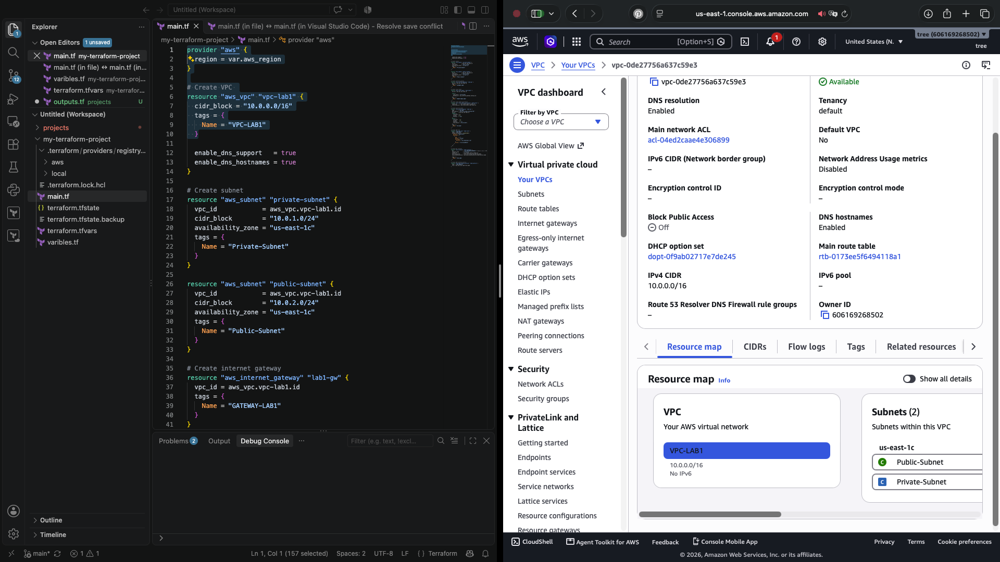
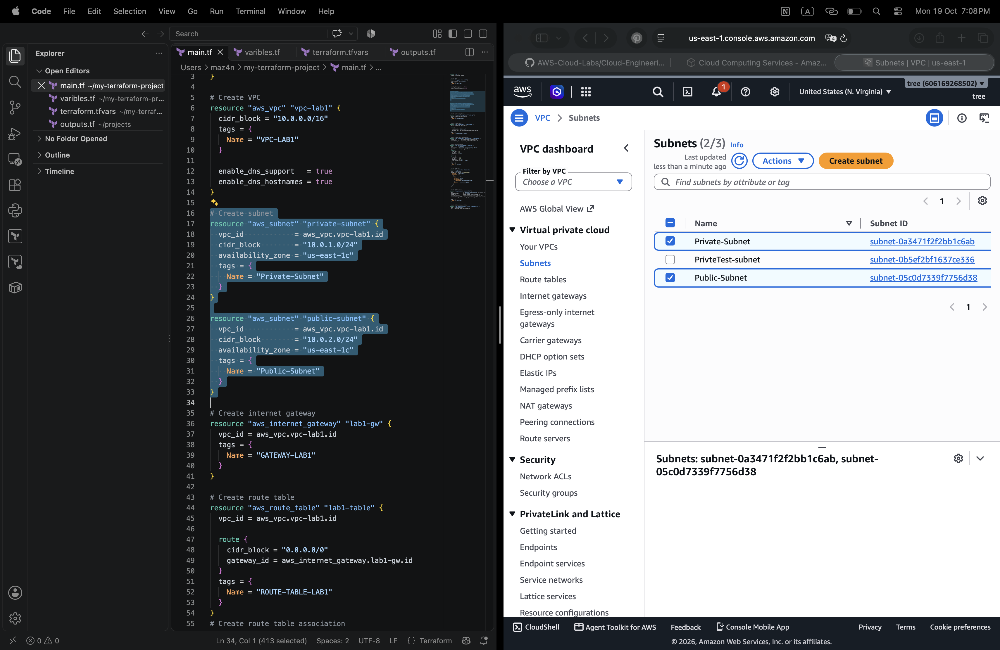
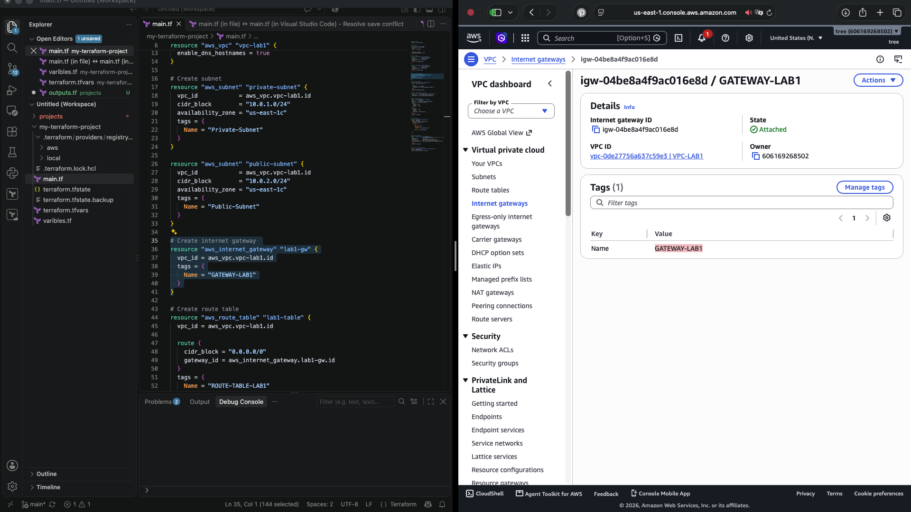
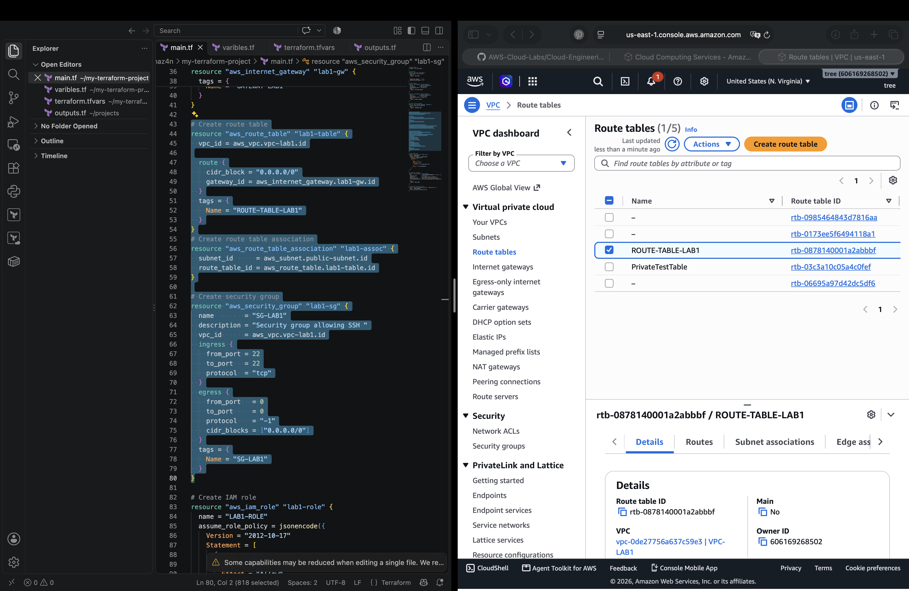
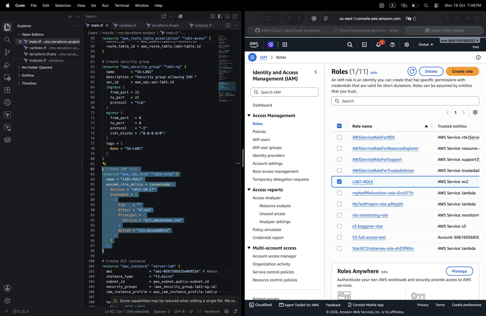
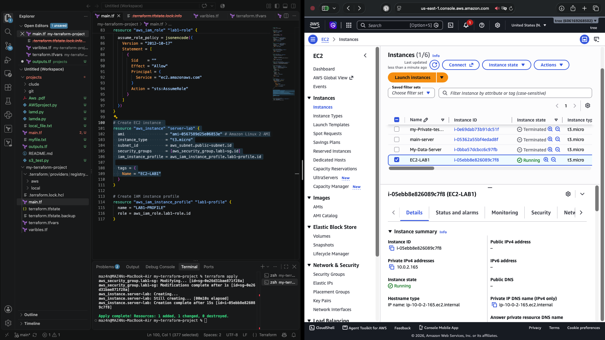
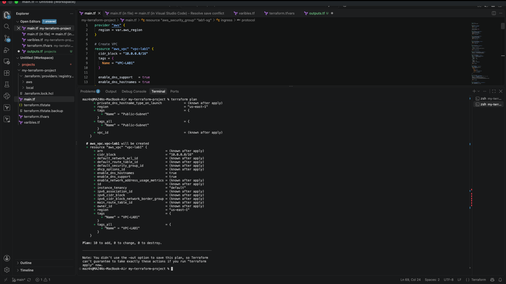
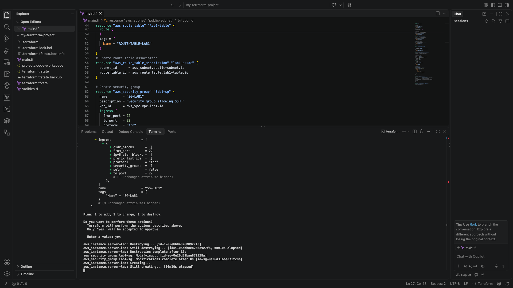

# ☁️ Secure AWS Infrastructure with Terraform

## 📌 Overview

In this project, I built an AWS infrastructure environment using Terraform and Infrastructure as Code (IaC) to understand how cloud resources are provisioned, configured, and managed.

The project focuses on:

- Infrastructure as Code (IaC)
- AWS Resource Provisioning
- VPC and Subnet Configuration
- Public and Private Network Segmentation
- Internet Gateway and Route Tables
- Security Groups
- IAM Roles and Instance Profiles
- EC2 Instance Deployment
- Terraform Planning and Deployment
- Cloud Infrastructure Security

---

## 🗺️ Architecture Design

In (a1), I explored the AWS VPC Resource Map to visualize the infrastructure and understand how the AWS components connect together.

The architecture includes:

- Amazon VPC
- Public and Private Subnets
- Internet Gateway
- Route Table
- Security Group
- IAM Role and Instance Profile
- Amazon EC2 Instance



---

## 🏗️ Creating the VPC and Subnets

I configured a Virtual Private Cloud (VPC) named `VPC-LAB1` with the CIDR block `10.0.0.0/16`.

The VPC contains public and private subnets to demonstrate network segmentation and resource organization.



---

## 🌐 Internet Gateway Configuration

In (a2), I created an Internet Gateway named `GATEWAY-LAB1` and attached it to the VPC.

An Internet Gateway enables communication between a VPC and the internet when the required routing and addressing configurations are in place.



---

## 🛣️ Route Table Configuration

In (a3), I inspected the Route Table configuration to understand how network traffic is routed within the VPC.

Route tables contain routing rules that determine where traffic is directed based on its destination.



---

## 🛡️ Configuring Security Groups

In (a4), I configured and inspected a Security Group named `lab1-sg` to control inbound and outbound network traffic associated with the EC2 instance.

Security Groups act as virtual firewalls that determine which network connections are allowed.



Security considerations:

- Restrict SSH access to trusted IP addresses.
- Allow only the network traffic required by the workload.
- Avoid unnecessarily exposing management ports.
- Review inbound and outbound rules before deployment.

---

## 🔑 IAM Role and Instance Profile

In (a5), I configured an IAM Role and Instance Profile as part of the AWS infrastructure.

IAM Roles allow AWS resources to obtain temporary credentials for authorized AWS API operations without embedding long-term credentials in application code.


The IAM configuration should follow the principle of least privilege by granting only the permissions required for the intended workload.

---

## 🖥️ Deploying the EC2 Instance

In (a6), I deployed an EC2 instance named `EC2-LAB1` within the VPC environment.

The instance reached the `Running` state and had the private IPv4 address `10.0.2.165`.



This demonstrated how Terraform can provision compute resources and integrate them with AWS networking components.

---

## 🧪 Terraform Plan

In (a7), I used `terraform plan` to preview the infrastructure changes before applying the configuration.

```bash
terraform plan
```

The recorded plan showed:

```text
Plan: 10 to add, 0 to change, 0 to destroy.
```

This indicated that Terraform planned to create ten resources without changing or destroying existing resources in that plan.



---

## 🚀 Applying the Terraform Configuration

In (a8), I applied the Terraform configuration to provision the AWS resources.

```bash
terraform apply
```



---

## 📤 Terraform Outputs

In (a9), I used the following command to inspect the output values defined in `outputs.tf`.

```bash
terraform output
```


Outputs can display useful information about deployed resources, depending on which output values are defined in the configuration.

---

## 🔒 Security and State Management

Terraform state files and sensitive configuration files must be handled carefully.

Important practices:

- Do not commit `terraform.tfstate` or backup state files.
- Never upload AWS credentials, access keys, or other secrets.
- Exclude sensitive local configuration files from Git where appropriate.
- Provide a sanitized `terraform.tfvars.example` file for reference.
- Review IAM permissions and Security Group rules before deployment.
- Use a secure remote state backend with access controls and state locking for collaborative environments.

---

## 🛠️ Tools Used

- Amazon Web Services (AWS)
- Terraform
- HashiCorp Configuration Language (HCL)
- Amazon VPC
- Amazon EC2
- AWS IAM
- AWS Security Groups
- Git
- GitHub

---

## 🧠 Skills Practiced

- Infrastructure as Code (IaC)
- AWS Resource Provisioning
- VPC and Subnet Configuration
- Cloud Network Segmentation
- Route Table Configuration
- Internet Gateway Integration
- Security Group Configuration
- IAM Roles and Instance Profiles
- EC2 Deployment
- Terraform Initialization and Validation
- Infrastructure Planning and Deployment
- Cloud Infrastructure Security
- Git and GitHub Documentation

---

## 🎯 What I Learned

This project provided hands-on experience with provisioning AWS infrastructure using Terraform.

I learned how to define cloud resources as code, organize Terraform configuration files, review planned changes, and deploy resources in AWS.

I also strengthened my understanding of VPC networking, subnet segmentation, routing, Security Groups, IAM Roles, and EC2 deployment.

---

## 📚 Conclusion

This lab demonstrated how Terraform can be used to provision and manage AWS infrastructure through repeatable configuration files rather than relying entirely on manual console operations.

It also highlighted the importance of reviewing infrastructure changes, controlling network access, applying least-privilege permissions, and protecting Terraform state and sensitive configuration data.

This project represents a practical step toward building and managing cloud infrastructure using Infrastructure as Code.