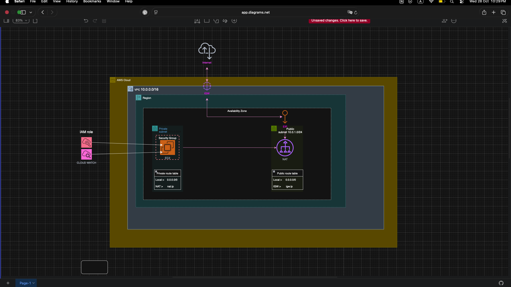
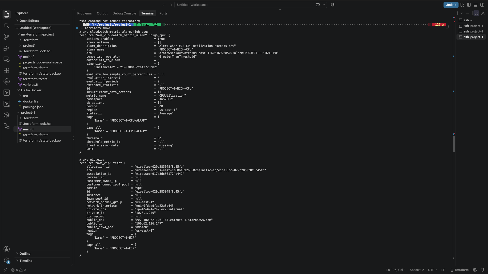
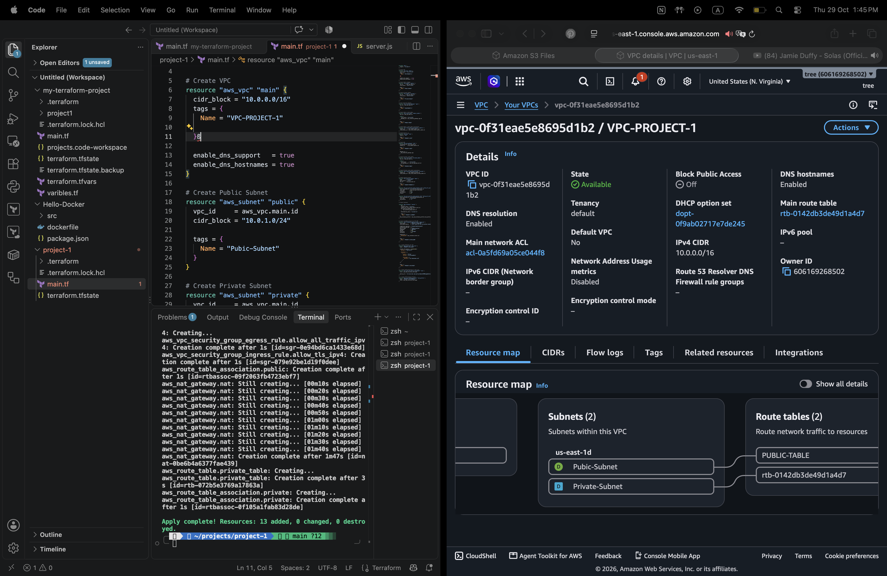
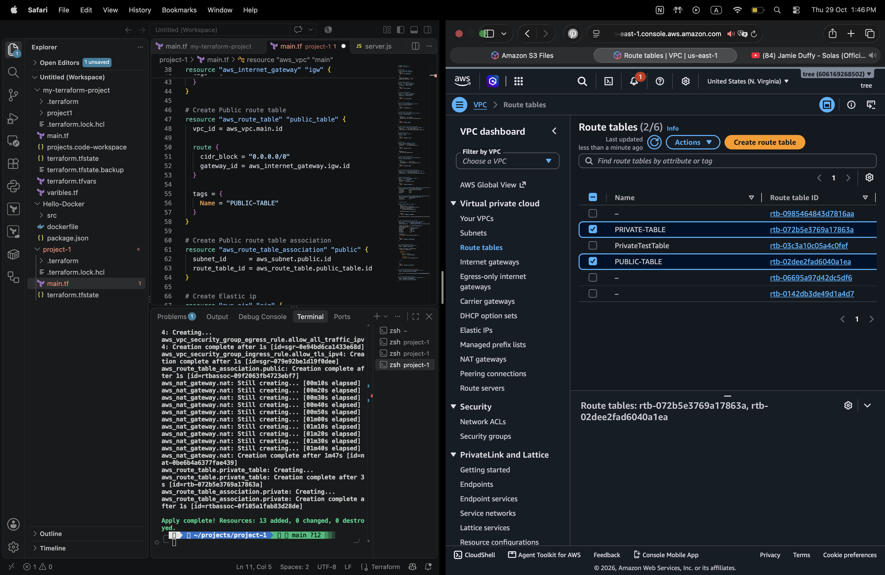
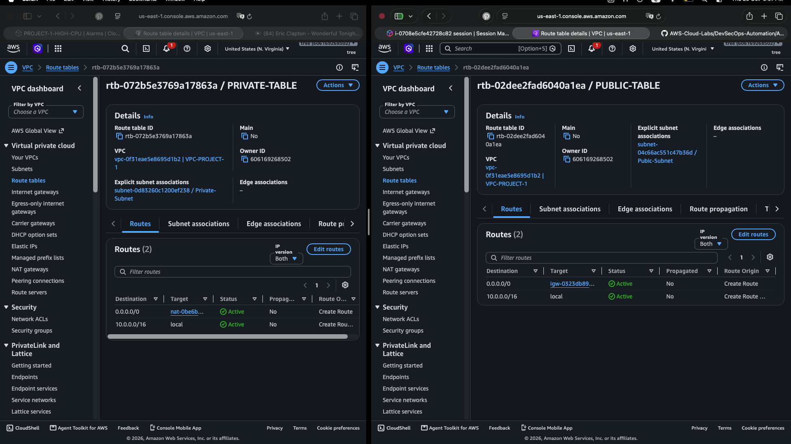
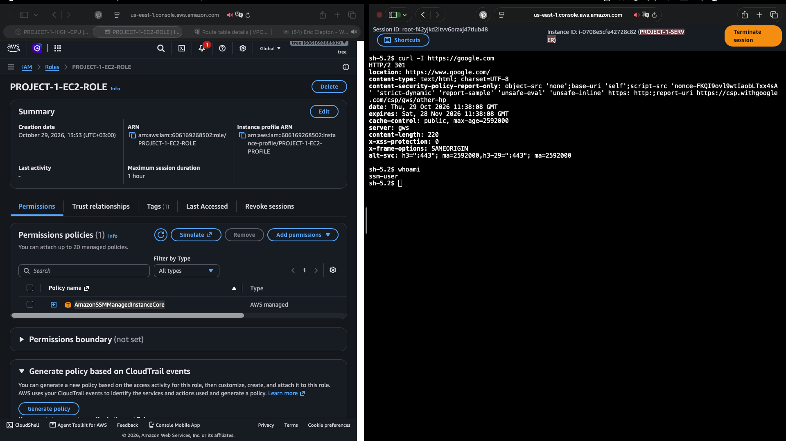
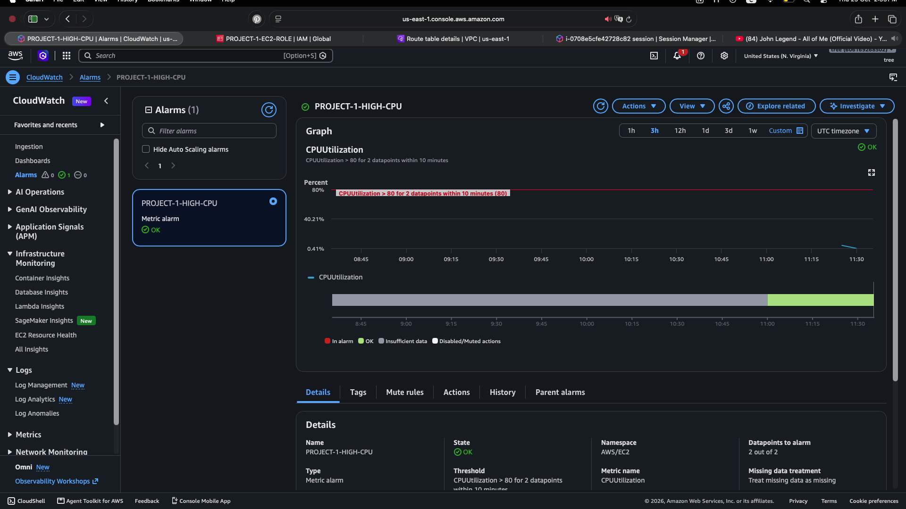

# ☁️ Secure AWS Infrastructure with Terraform

## 📌 Overview

A hands-on Infrastructure as Code (IaC) project using Terraform to provision AWS networking infrastructure, manage private EC2 access, and monitor system performance with Amazon CloudWatch.

---

# 🏗️ 1. Infrastructure Architecture

The project uses a custom VPC with separate public and private subnets, an Internet Gateway, a NAT Gateway, and dedicated route tables.

### 🖼️ AWS Resource Map



---

# ⚙️ 2. Terraform Deployment

Terraform is used to define, validate, plan, and provision the AWS infrastructure.

Commands used:

```bash
terraform init
terraform fmt
terraform validate
terraform plan
terraform apply
```

### 🖼️ Terraform Apply Success



---

# 🌐 3. Amazon VPC Configuration

The project uses a custom VPC in the `us-east-1` region.

| Component | CIDR |
|---|---|
| VPC | `10.0.0.0/16` |
| Public Subnet | `10.0.1.0/24` |
| Private Subnet | `10.0.2.0/24` |

### 🖼️ VPC Details



---

# 🏘️ 4. Public and Private Subnets

The VPC contains separate public and private subnets to support network segmentation.

- **Public Subnet:** `10.0.1.0/24`
- **Private Subnet:** `10.0.2.0/24`

### 🖼️ Subnet Configuration



---

# 🔀 5. Route Tables

The public route table directs default internet-bound traffic to the Internet Gateway. The private route table directs default outbound IPv4 traffic to the NAT Gateway.

### 🖼️ Route Table Configuration



---

# 🖥️ 6. Amazon EC2 Instance

The project includes an EC2 instance intended to run in the private subnet and use AWS Systems Manager for administrative access.

### 🖼️ EC2 Instance



---

# 👤 7. IAM Role and Systems Manager

The EC2 instance uses an IAM role with the `AmazonSSMManagedInstanceCore` policy to support Systems Manager access.

The instance profile associates the role with the EC2 instance.

---

# 📊 8. CloudWatch Monitoring

A CloudWatch alarm monitors EC2 CPU utilization against a threshold of 80% over two consecutive five-minute evaluation periods.

### 🖼️ CloudWatch CPU Alarm



The screenshot shows the alarm in the `OK` state when captured. This indicates that the alarm was not breaching its configured threshold at that moment.

---

# 🛡️ 9. Security Considerations

- 🔐 Use IAM roles instead of storing long-term AWS credentials on EC2.
- 🔒 Restrict Security Group inbound rules to required sources and ports.
- 🌐 Keep workloads in private subnets when public access is unnecessary.
- 🔑 Use Systems Manager Session Manager where configured.
- 🚫 Never commit AWS credentials, Terraform state files, or sensitive configuration files to GitHub.

---

# 🧰 10. Technologies Used

- ☁️ Amazon Web Services (AWS)
- ⚙️ Terraform
- 🌐 Amazon VPC
- 🏘️ Public and Private Subnets
- 🌍 Internet Gateway
- 🔀 NAT Gateway
- 📍 Elastic IP
- 🛡️ Security Groups
- 👤 AWS IAM
- 🖥️ Amazon EC2
- 🔑 AWS Systems Manager
- 📊 Amazon CloudWatch
- 📝 Git and GitHub

---

# 🚀 11. Deployment Commands

```bash
terraform init
terraform fmt
terraform validate
terraform plan
terraform apply
```

Review the proposed changes and potential AWS charges before confirming deployment.

---

# 🧹 12. Cleanup

Review the resources that Terraform proposes to remove:

```bash
terraform plan -destroy
```

Remove the infrastructure when you are certain it is no longer needed:

```bash
terraform destroy
```

---

# 📁 13. Repository Structure

```text
Secure-AWS-Infrastructure-Terraform/
├── README.md
├── main.tf
└── screenshots/
    ├── 03-terraform-apply-success.png
    ├── 04-vpc-details.png
    ├── 05-vpc-resource-map.png
    ├── 06-subnets-details.png
    ├── 08-route-tables.png
    ├── 10-ec2-instance-running.png
    └── 14-cloudwatch-cpu-alarm.png
```

---

# 🧠 14. Learning Outcomes

Through this project, I practised:

- 🌐 AWS networking and subnet segmentation.
- 🔀 Route table configuration.
- 🌍 Internet Gateway and NAT Gateway concepts.
- 🛡️ Security Group configuration.
- 👤 IAM roles and instance profiles.
- 🔑 Private EC2 administration through Systems Manager.
- 📊 CloudWatch monitoring and alarm configuration.
- ⚙️ Infrastructure provisioning with Terraform.
- 📝 Technical documentation and version control with Git and GitHub.

---

## 📌 Project Information

- **Project:** Secure AWS Infrastructure with Terraform
- **Cloud Provider:** Amazon Web Services
- **Infrastructure as Code:** Terraform
- **Region:** `us-east-1`
