# AWS Security Monitoring & Auto-Remediation with Terraform

Infrastructure as Code project that provisions an AWS network environment and implements security monitoring and event-driven remediation.

The project demonstrates how AWS networking, logging, monitoring, and serverless services can work together to detect selected security-group changes and respond automatically.

> **Project status:** Infrastructure screenshots are available. Confirm the end-to-end remediation and notification tests before describing the complete workflow as production-ready.

## Table of Contents

- [Objectives](#objectives)
- [Architecture](#architecture)
- [AWS Resources](#aws-resources)
- [Security Event Workflow](#security-event-workflow)
- [Repository Structure](#repository-structure)
- [Prerequisites](#prerequisites)
- [Deployment](#deployment)
- [Validation and Testing](#validation-and-testing)
- [Cleanup](#cleanup)
- [Security and Cost Considerations](#security-and-cost-considerations)
- [Limitations](#limitations)

## Objectives

- Provision AWS infrastructure using Terraform.
- Separate public and private network resources.
- Deploy an EC2 instance in a private subnet.
- Record AWS API activity with CloudTrail and store logs in S3.
- Use EventBridge to identify selected security-related events.
- Use Lambda to perform a configured remediation action.
- Monitor EC2 CPU utilization with CloudWatch.
- Send notifications through Amazon SNS.

## Architecture

The environment uses a VPC with public and private subnets. The public subnet contains the internet-facing network components, while the EC2 instance is deployed in the private subnet.

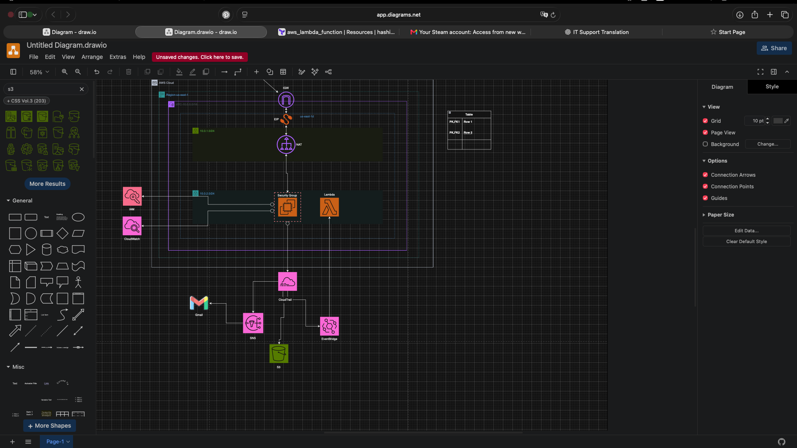

> **Diagram note:** The source image is marked as a draft. Update and verify the diagram before treating it as the final architecture.

## AWS Resources

### Networking

The project uses the following network configuration in `us-east-1`:

| Resource | Configuration |
|---|---|
| VPC | `10.0.0.0/16` |
| Public subnet | `10.0.1.0/24` |
| Private subnet | `10.0.2.0/24` |
| Availability Zone | `us-east-1c` |
| Public routing | Internet Gateway |
| Private outbound routing | NAT Gateway |

#### VPC

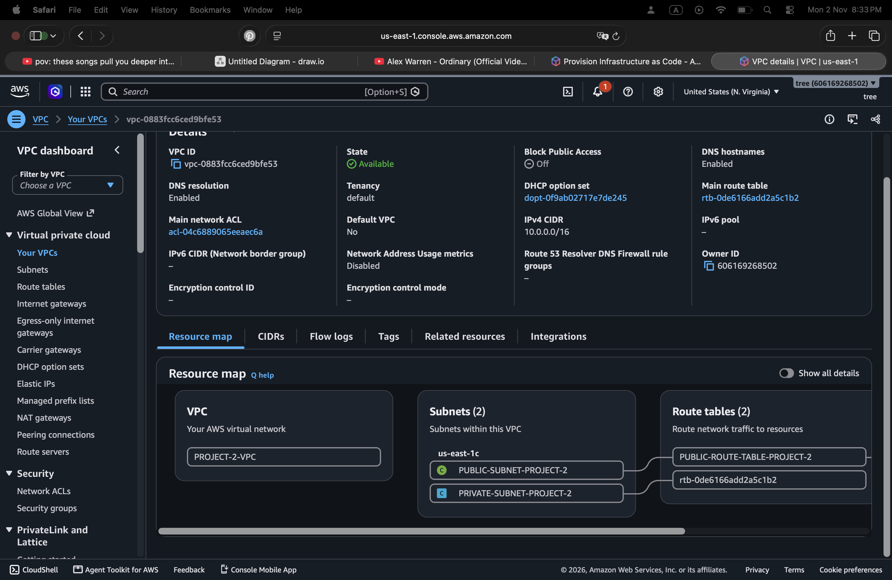

#### Subnets

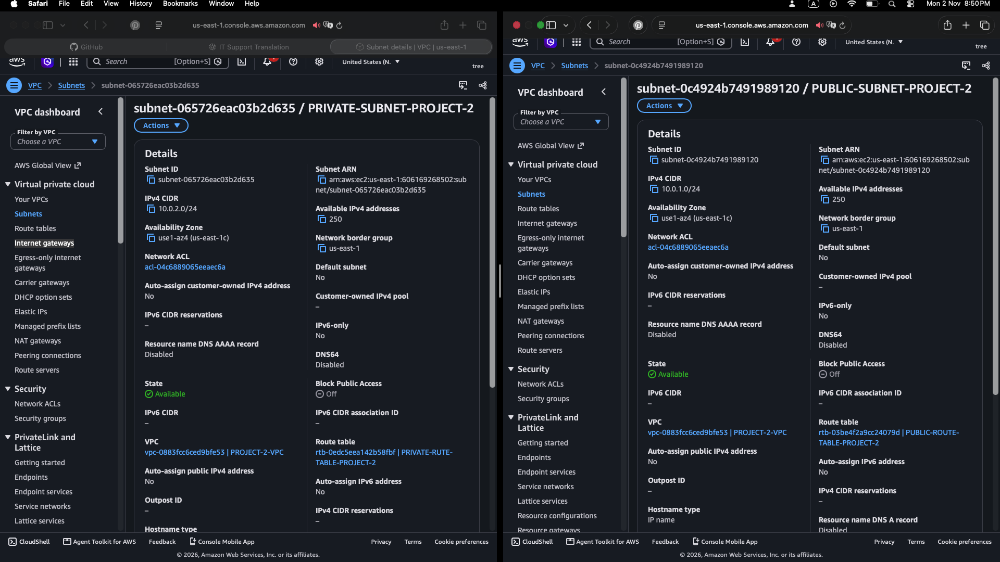

#### Route tables

The public route table directs internet-bound traffic to the Internet Gateway. The private route table directs outbound traffic through the NAT Gateway.

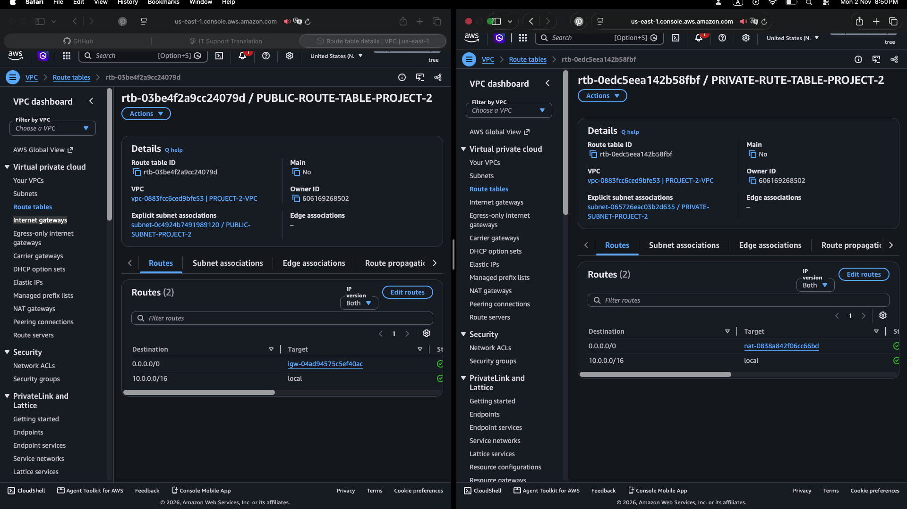

#### Internet and NAT gateways

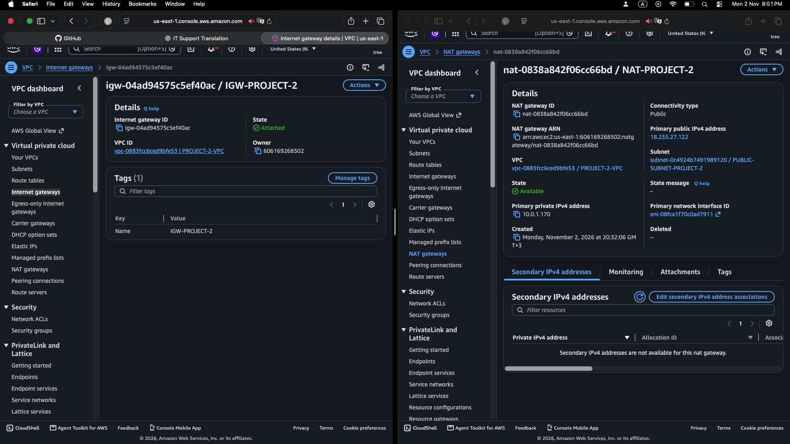

### EC2 and Access Management

The EC2 instance is deployed in the private subnet and has no public IPv4 address. An IAM role is associated with the instance for AWS access, including Systems Manager where configured.

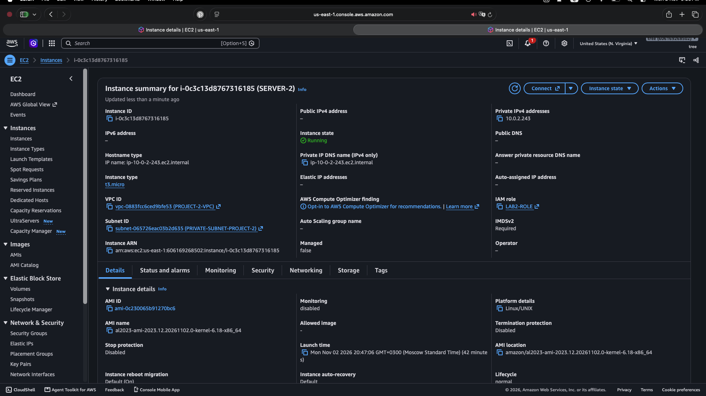

The security group and IAM role configuration are shown below.

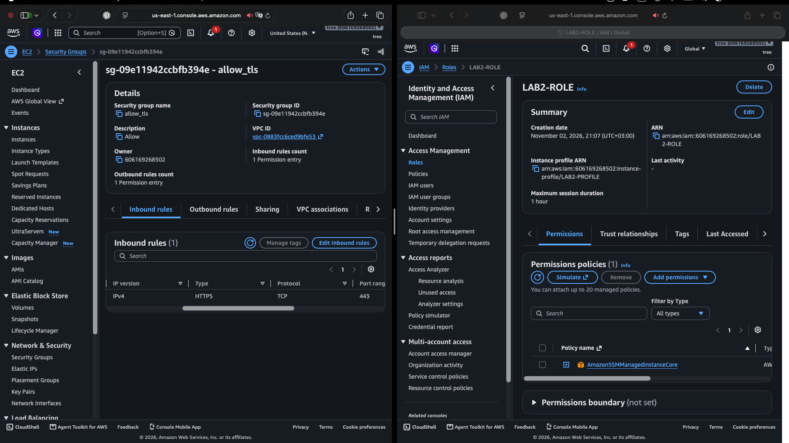

Systems Manager can provide administrative access without requiring a public IP address or an inbound SSH rule, when the instance and account are configured correctly.

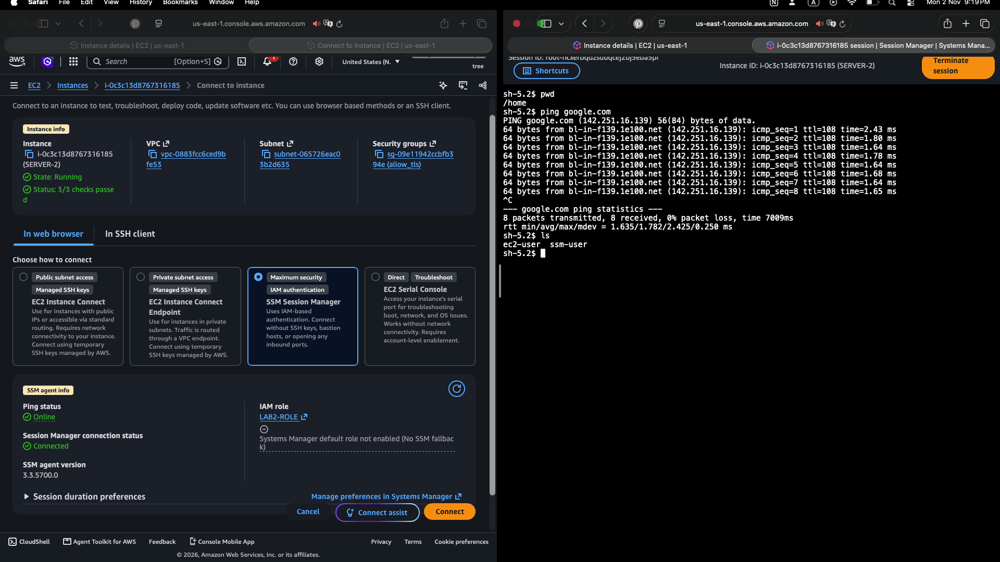

## Security Event Workflow

The intended security workflow is:

1. An AWS API action changes a security-group ingress rule.
2. CloudTrail records the API activity.
3. EventBridge matches the configured event pattern.
4. EventBridge invokes the Lambda remediation function.
5. Lambda evaluates the event and performs the configured response.
6. SNS is used to send a notification.

CloudTrail also stores its log files in S3 for retention and review. EventBridge receives matching events from the event bus; it does not read the S3 log files to trigger this workflow.

### CloudTrail

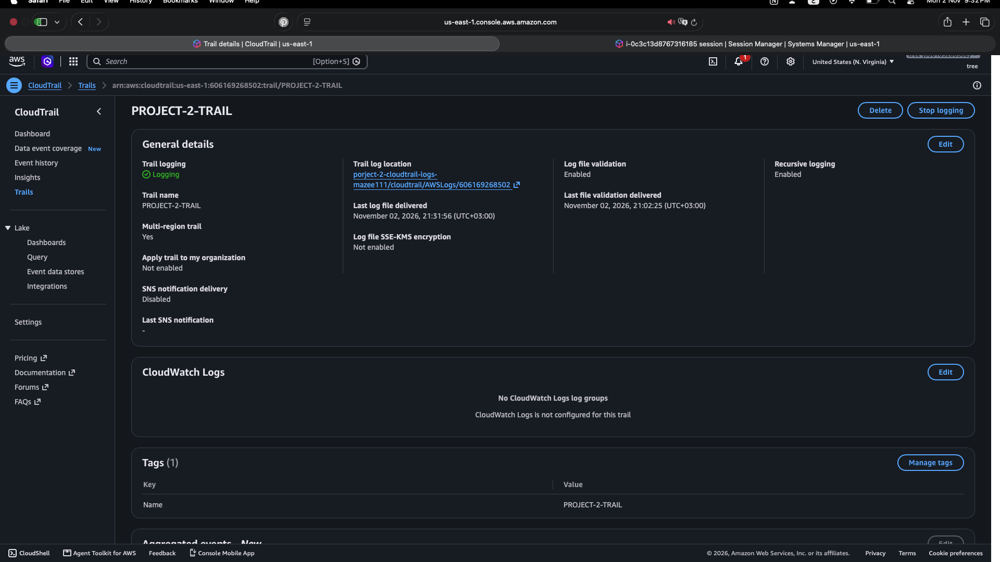

### S3 log storage

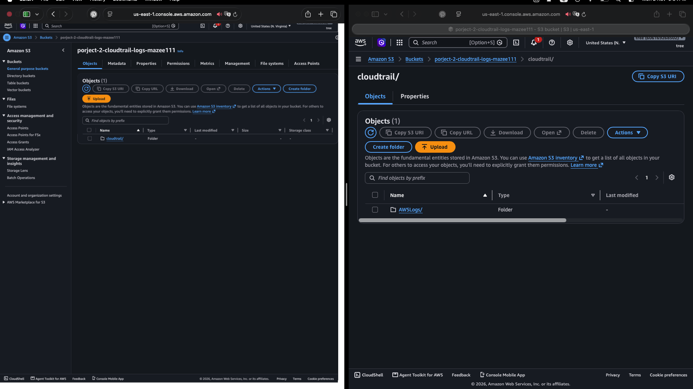

### CloudWatch alarm

A CloudWatch alarm is configured to monitor EC2 CPU utilization.

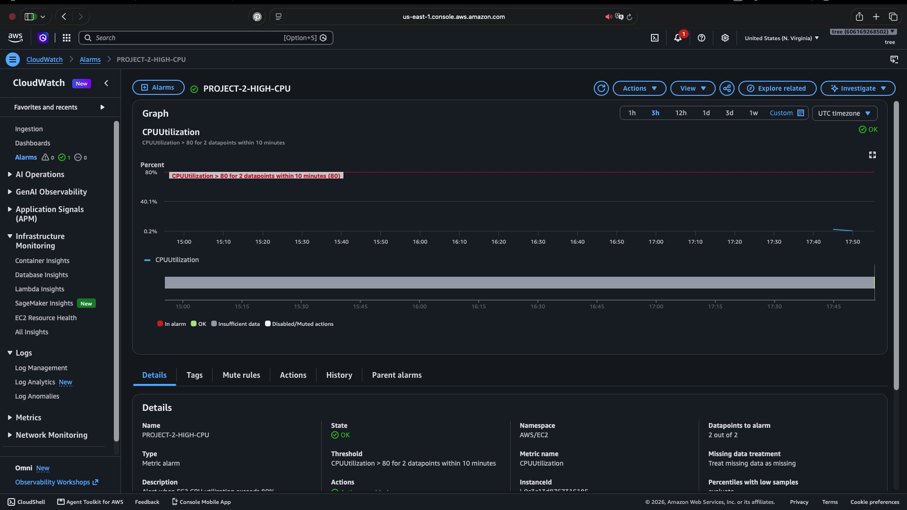

### Lambda remediation

The Lambda function is intended to respond to selected security-group ingress events and apply the remediation defined in its code.

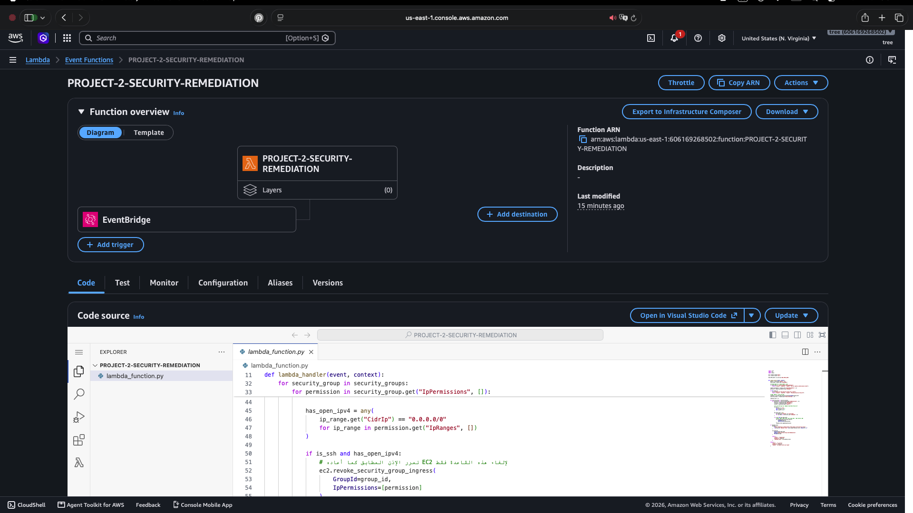

### SNS notifications

SNS is configured to deliver notifications. The screenshot shows the email subscription status at the time it was captured.

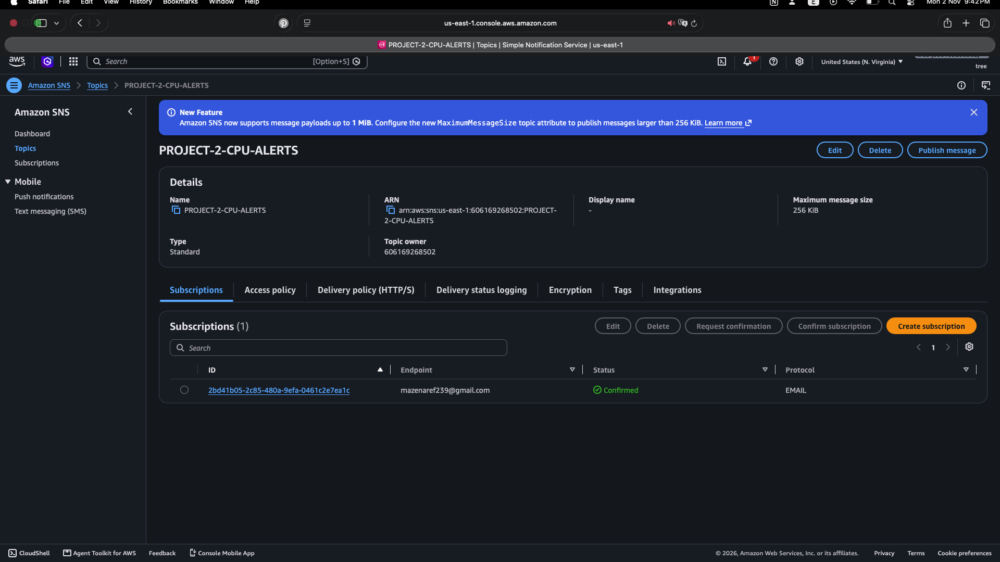

> **Action required:** The subscription shown is pending. Confirm the subscription email before relying on SNS email notifications.

## Repository Structure

```text
.
├── main.tf
├── lambda_function.py
├── README.md
└── screenshots/
    ├── 01-cloudtrail-trail-active.png
    ├── 02-sns-email-subscription-pending.png
    ├── 03-s3-cloudtrail-logs.png
    ├── 04-terraform-cloudwatch-alarm-applied.png
    ├── 05-lambda-remediation-function.png
    ├── 07-security-group-and-iam-role.png
    ├── 08-aws-security-monitoring-architecture-draft.png
    ├── 09-ssm-session-and-network-connectivity.png
    ├── 10-ec2-instance-with-iam-role.png
    ├── 10-vpc-details.png
    ├── 11-subnets-details.png
    ├── 12-route-tables.png
    ├── 14-igw-nat-gateway.png
    └── 15-terraform-apply-progress.png
```

## Prerequisites

Before deploying, install and configure:

- [Terraform](https://developer.hashicorp.com/terraform/install)
- [AWS CLI](https://docs.aws.amazon.com/cli/latest/userguide/getting-started-install.html)
- AWS credentials with permissions to create and manage the resources defined in the Terraform configuration

Configure the AWS CLI using an approved credential method. Do not commit access keys, secret keys, tokens, or other credentials to the repository.

## Deployment

Run these commands from the directory containing the Terraform configuration.

### 1. Initialize Terraform

```bash
terraform init
```

### 2. Format and validate

```bash
terraform fmt -recursive
terraform validate
```

### 3. Review the execution plan

```bash
terraform plan
```

Review the proposed changes before applying them.

### 4. Deploy the infrastructure

```bash
terraform apply
```

Confirm the operation only after reviewing the plan.

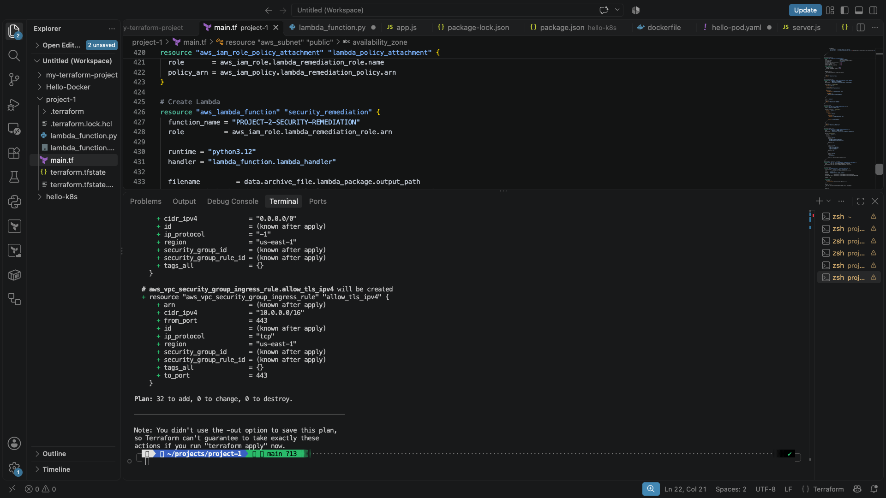

## Validation and Testing

After deployment, verify the following in the AWS Console and through the relevant logs:

- The VPC, subnets, route tables, Internet Gateway, and NAT Gateway are available.
- The EC2 instance is running in the private subnet.
- Systems Manager access works if it is part of the deployment.
- CloudTrail is recording the expected management events.
- CloudTrail log files are being delivered to the S3 bucket.
- The CloudWatch alarm has the expected configuration and state.
- The SNS email subscription is confirmed.
- EventBridge invokes the Lambda function for the configured event.
- The Lambda function performs the intended remediation in a test environment.
- The resulting action and notification appear in the relevant logs.

Do not test automated remediation against production security groups. Use a dedicated test security group and verify the rule before and after the test.

## Cleanup

When the environment is no longer needed, review the resources Terraform plans to remove, then run:

```bash
terraform destroy
```

Confirm the operation only after reviewing the destruction plan. Check the AWS Console afterward to ensure that no billable resources remain.

## Security and Cost Considerations

- Do not commit AWS credentials, private keys, Terraform state files, or sensitive outputs.
- Review IAM permissions and restrict them to the resources and actions required by the project.
- Test remediation logic in an isolated environment before using similar controls in production.
- NAT Gateways, public IPv4 addresses, CloudTrail storage, and other AWS services may incur charges.
- Remove resources when they are no longer needed.

## Limitations

- The architecture screenshot is marked as a draft and should be reviewed.
- The SNS screenshot shows a pending email subscription; email delivery is not confirmed by that image.
- Screenshots document the resources at the time they were captured. They do not independently prove that every monitoring and remediation scenario has been tested successfully.
- Review the Lambda implementation to understand exactly which ingress changes it handles and which cases are outside its scope.

## Disclaimer

This project is for educational and demonstration purposes. Validate the configuration, permissions, costs, and remediation behavior before adapting it for production use.